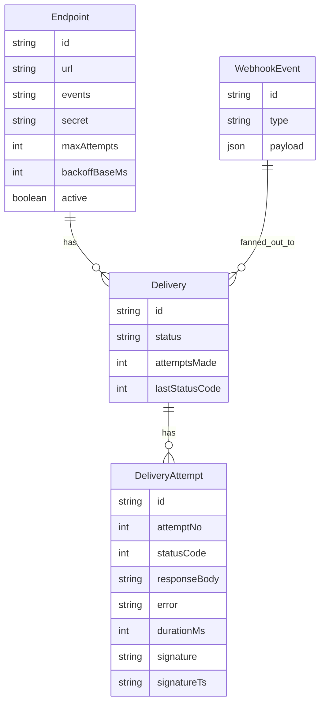

# Architecture

## Overview

The Webhook Delivery Platform is a small event-driven system. An Express API
accepts events and fans them out to registered webhook endpoints. A BullMQ
worker performs the actual HTTP deliveries with retries. PostgreSQL stores
everything durable: endpoints, events, deliveries, and every delivery
attempt. A Next.js dashboard reads PostgreSQL and shows the state of the
system. A demo receiver service stands in for customer endpoints so the
retry behavior can be watched end to end.

## Components

| Component | Code | Port | Depends on |
| --- | --- | --- | --- |
| API | `apps/api/src/index.ts` | 3001 | PostgreSQL, Redis |
| Worker | `apps/api/src/worker.ts` | none | PostgreSQL, Redis |
| Dashboard | `apps/web` (Next.js 14) | 3000 | API (from the browser) |
| Demo receiver | `apps/demo-receiver` | 3002 | none |
| PostgreSQL 17 | `docker-compose.yml` | 5432 | none |
| Redis 7 | `docker-compose.yml` | 6379 | none |

The API and the worker are two processes built from the same package
(`apps/api`). The API never delivers a webhook itself. The worker never
accepts HTTP requests. The dashboard never touches Redis; it only calls the
API from the browser.

## Data flow

```mermaid
flowchart LR
    Producer["Producer<br/>API client, dashboard form,<br/>or seed script"] -->|POST /api/events| API["Express API :3001"]
    API -->|persist event + deliveries| PG[("PostgreSQL<br/>Prisma")]
    API -->|enqueue one job per delivery| Redis[("Redis<br/>BullMQ queue<br/>webhook-deliveries")]
    Redis -->|consume, concurrency 10| Worker["BullMQ worker"]
    Worker -->|POST signed JSON<br/>10s timeout| Customer["Customer endpoint"]
    Worker -->|record attempt + update status| PG
    Dashboard["Next.js dashboard :3000"] -->|GET /api/stats, /api/endpoints,<br/>/api/deliveries (from browser)| API
```

### Publishing an event

1. `POST /api/events` with `{ type, payload }` reaches `publishEvent`
   (`apps/api/src/lib/publish.ts`).
2. The event is stored as a `WebhookEvent` row.
3. Active endpoints subscribed to that type are loaded. An endpoint with an
   empty `events` array is subscribed to all event types.
4. One `Delivery` row is created per subscribed endpoint, with status
   `queued`.
5. Each delivery is enqueued on BullMQ as one job with `jobId` set to the
   delivery id, so the same delivery is never queued twice. The job carries
   the endpoint retry policy captured at enqueue time: `attempts` is the
   endpoint `maxAttempts` and `backoff` is exponential with base
   `backoffBaseMs`.

### Delivering a webhook

One worker run is one delivery attempt (`apps/api/src/worker.ts`):

1. The worker loads the delivery with its endpoint and event. If the endpoint
   was deactivated while the job was queued, the delivery is marked `failed`
   immediately and no HTTP request is made.
2. The delivery is marked `delivering` and `attemptsMade` is incremented.
3. The raw JSON body is signed (see below) and POSTed to the endpoint URL
   with a 10 second timeout (`apps/api/src/lib/deliver.ts`).
4. A `DeliveryAttempt` row is written with the attempt number, HTTP status
   code, response body truncated to 4 KB, error message, duration, and the
   signature that was sent.
5. On a 2xx response the delivery is `delivered`.
6. On failure with attempts remaining, the delivery goes back to `queued`
   and the job throws, so BullMQ retries it with exponential backoff
   (delays of base, 2x base, 4x base, and so on).
7. On the final failed attempt the delivery is `failed` and the job
   completes. There is no infinite retry loop.

Changing an endpoint `maxAttempts` or `backoffBaseMs` later does not affect
deliveries that are already queued, because the policy was captured on the
job at enqueue time.

## Signing

Every delivery attempt is signed Stripe-style (`apps/api/src/lib/sign.ts`):

- Header `X-Webhook-Signature` carries `t=<unix_ts>,v1=<hex>`.
- The HMAC is SHA-256 over `<ts>.<raw_json_body>` using the endpoint secret.
- The delivery id is stable across retries (`X-Webhook-Delivery-Id`), so a
  receiver can deduplicate repeated deliveries of the same event.
- A `verify()` helper recomputes the HMAC, compares in constant time, and
  rejects timestamps more than 5 minutes old (replay protection).

Other headers sent with each attempt: `Content-Type: application/json`,
`X-Webhook-Event-Type`, and `X-Webhook-Timestamp`.

## Data model



The Prisma schema is in `apps/api/prisma/schema.prisma`. Delivery status is
a plain string by convention: `queued`, `delivering`, `delivered`, or
`failed`. Deleting an endpoint cascades to its deliveries, and deleting a
delivery cascades to its attempts.

## Demo receiver

The demo receiver (`apps/demo-receiver`) is a stand-in customer. It has four
endpoints:

- `/ok`: returns 200 immediately.
- `/slow`: returns 200 after a 3 second delay, inside the 10 second
  delivery timeout.
- `/flaky`: returns 500 for the first two hits of each delivery id, then
  200. This shows retry recovery.
- `/dead`: always returns 500. This shows retries exhausting and the
  delivery ending `failed`.

The flaky hit counter is in-memory. It resets on restart and does not work
across replicas. That is intentional for a demo and is documented as a
limitation.

## Decisions and trade-offs

- **One queue, one job per delivery.** Simple to reason about and to inspect
  in the dashboard. A high-volume system would batch or shard queues.
- **Retry policy captured at enqueue time.** Predictable behavior for a
  delivery once it exists. The cost is that policy edits do not apply to
  deliveries already queued.
- **PostgreSQL as the source of truth, Redis as the queue only.** If Redis
  is lost, queued jobs are lost, but the delivery rows in PostgreSQL still
  show what was pending. There is no reconciliation job that re-queues
  orphaned deliveries yet.
- **Single worker process, concurrency 10.** Enough for a demo and for
  learning. There is no horizontal worker scaling, leader election, or
  dead-letter queue beyond the `failed` status.
- **No authentication on the API.** This is a learning project. Do not
  expose it publicly without adding auth in front of it.

## What is not verified

- Docker Compose and the Prisma migration have not been run against a live
  database in the environment where these docs were written. The migration
  in `apps/api/prisma/migrations/0001_init/` was hand-authored. Run
  `prisma migrate dev` against a real database and review the diff before
  treating it as canonical.
- The worker retry lifecycle has not been observed end to end here, because
  that needs PostgreSQL and Redis running. The code path is reviewed and the
  pieces around it (build, schema validation, health endpoint, demo
  receiver) were run on 2026-11-06. See `docs/screenshots/` for the real
  output.
